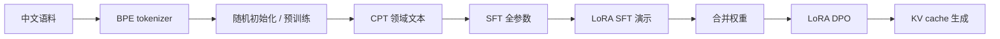

# HanLM：从 tokenizer 到中文语言模型生成

这是一个可以读懂、修改和运行的 PyTorch 训练工程，包含自训练 tokenizer、自定义 decoder-only Transformer、预训练、继续预训练（CPT）、监督微调（SFT）、LoRA 参数高效微调（PEFT）、直接偏好优化（DPO）、评估和生成。

提供两种配置：Mac/CPU 跑通用的小模型，以及 **97,536,768 参数（约 0.1B）**的正式模型。示例数据全部为中文，但 byte-level tokenizer 保留字节覆盖能力，不强制限制输出字符集。示例训练仅用于验证工程，不是训练好的中文助手。

## 1. 先跑通完整流程

需要 Python 3.10–3.13；本机验证版本为 Python 3.11、PyTorch 2.8.0、tokenizers 0.22.2。当前工作区已安装 `.venv`，可以直接执行：

```bash
.venv/bin/python scripts/demo.py --steps 8 --device cpu
```

在新环境安装：

```bash
python3.11 -m venv .venv
source .venv/bin/activate
python -m pip install -e '.[dev]'
python scripts/demo.py --steps 8 --device cpu
python -m pytest -q
```

`requirements-lock.txt` 记录本次 Mac/Python 3.11 验证环境的精确依赖版本；需要复现时可用 `python -m pip install -r requirements-lock.txt`。其他平台特别是 CUDA 环境，应按对应 PyTorch 安装方式选择适配的构建。

脚本自动建立新的 `runs/demo-时间戳/` 目录，并完成：



**PEFT 是参数更新方式，不是必须接在 SFT 后面的独立目标。** 通常选用“全参数 SFT”或“LoRA SFT”之一，再进入 DPO。演示为展示全部操作，两种方式都运行；DPO 也支持 `--method full` 或 `--method lora`。这里的 LoRA 是本仓库实现，不依赖 Hugging Face PEFT。

每个训练阶段生成：

| 文件 | 内容 |
|---|---|
| `last.pt` | 最近一次保存的模型、优化器、步数、采样器和随机状态 |
| `best.pt` | 验证损失最低时的完整 checkpoint |
| `tokenizer.json` | 该模型使用的 tokenizer |
| `run.json` | 参数及训练/验证文件哈希 |
| `metrics.jsonl` | 每一步的损失、学习率、梯度范数和验证指标 |

LoRA checkpoint 为便于搬迁，包含底座和适配器完整权重；**不是仅含 adapter 的小文件**。DPO checkpoint 额外保存训练开始时的固定参考模型。`merge` 导出不含优化器的纯模型，可用于生成或下一阶段初始化，不能用于原阶段精确续训。

## 2. 模型配置与源码

| 配置项 | `configs/tiny.json` | `configs/100m.json` |
|---|---:|---:|
| 词表 | 根据 tokenizer 自动确定 | 16,384 |
| 层数 | 2 | 12 |
| 隐藏维度 | 64 | 768 |
| 注意力头数 | 4 | 12 |
| FFN 中间维度 | 176 | 2,048 |
| 最大上下文 | 256 | 1,024 |
| 参数量 | 演示实测 137,856 | 97,536,768 |

参数量公式（输入与输出共享 embedding）：

```text
V × d + L × (4 × d² + 3 × d × f + 2 × d) + d
```

采用 pre-norm、RMSNorm、RoPE、多头因果注意力、SwiGLU 和共享 embedding，无 bias、无 dropout。注意力使用 PyTorch SDPA；是否使用融合内核取决于设备与输入。推理提供 KV cache、greedy、temperature、top-k、top-p。

| 文件 | 阅读重点 |
|---|---|
| `hanlm/model.py` | 模型结构、RoPE、KV cache、LoRA 和合并 |
| `hanlm/data.py` | BPE、聊天模板、label mask、语料打包 |
| `hanlm/objectives.py` | next-token loss 与 DPO 公式 |
| `hanlm/engine.py` | 训练、验证、checkpoint、恢复、生成 |
| `hanlm/cli.py` | 所有命令和参数 |
| `scripts/demo.py` | 各阶段如何衔接 |
| `tests/test_core.py` | 因果性、缓存、mask、LoRA、DPO、续训一致性 |

## 3. 数据格式

所有输入为 UTF-8 JSONL，每行一个 JSON 对象。示例见 `data/demo/`。工程不会自动下载外部数据。

**预训练 / CPT / tokenizer：**

```json
{"text":"这是一篇完整的中文文档。可以包含多段内容。"}
```

一行是一篇文档。文本执行 NFC 规范化、换行规范化与首尾去空白，然后按整篇内容去重、哈希分流至训练集和验证集。Tokenizer 训练只读取同一划分中的训练部分，`tokenizer` 和 `prepare` 必须使用相同的 `--val-fraction` 和 `--seed`。

打包格式为小端 uint32 token 序列，使用 `numpy.memmap` 读取。文档之间插入 EOS/BOS；训练块可以跨文档，注意力不在文档边界重置。每块取 `seq_len + 1` 个 token，输入和标签错位一位；尾部不足一块的 token 不参与训练。不要在各阶段独立重训 tokenizer，后续阶段必须复用预训练词表。

**SFT（支持多轮）：**

```json
{"messages":[{"role":"system","content":"请用中文简洁回答。"},{"role":"user","content":"什么是分词器？"},{"role":"assistant","content":"分词器把文本转换为模型可以处理的词元序列。"}]}
```

`system` 可省略，若存在必须在开头；user/assistant 交替，最后一条为 assistant。模板由专用 token 构建，训练与生成共用。只有 assistant 正文和回复结尾 EOS 计算损失，角色标记、system、user、padding 的标签为 `-100`。多轮样本监督所有 assistant 回复。

**DPO：**

```json
{"prompt":"什么是分词器？","chosen":"分词器把文本转换成词元编号。","rejected":"分词器可以增加计算机的物理内存。"}
```

`prompt` 也可以是以 user 结尾的消息列表。chosen/rejected 是回答正文字符串，不包含角色模板；必须对应相同的问题且内容不同。DPO 只计算最后的候选回答和 EOS 的 log-probability，即使 prompt 中包含历史 assistant 回复，也不会将其计入目标。

SFT/DPO 的训练集与验证集由你事先分好，建议按问题或来源分组，避免相同/近似问题泄漏。程序拒绝完全相同的训练/验证文件，但不执行语义近重复检测。超出 `seq_len + 1` 的样本明确报错，避免无声截断掉回答或改变偏好对。

原始内容不能包含保留控制 token（例如 `<assistant>`）；这种情况需要先清洗。当前普通语料去重集合和 SFT/DPO 样本保存在内存，超大数据应扩展为外部去重和分片加载。

## 4. 使用真实中文数据训练约 0.1B 模型

下面命令假设已激活 `.venv`，并准备好 `data/zh_pretrain.jsonl`、`data/zh_domain.jsonl`、`data/sft_train.jsonl`、`data/sft_val.jsonl`、`data/dpo_train.jsonl`、`data/dpo_val.jsonl`。这些真实数据不包含在仓库里。

### Tokenizer 与语料准备

```bash
python -m hanlm.cli tokenizer \
  --input data/zh_pretrain.jsonl \
  --output artifacts/zh/tokenizer.json --vocab-size 16384

python -m hanlm.cli prepare \
  --input data/zh_pretrain.jsonl --tokenizer artifacts/zh/tokenizer.json \
  --output artifacts/pretrain

python -m hanlm.cli prepare \
  --input data/zh_domain.jsonl --tokenizer artifacts/zh/tokenizer.json \
  --output artifacts/cpt
```

词表大小是训练上限，小语料可能无法训练出 16,384 个 token。正式配置要求 tokenizer 的实际词表与配置完全一致，不会悄悄缩小模型。先增加真实语料，或明确修改配置并重新核算参数量；演示配置中的 `vocab_size: 0` 才会自动适配。

### 预训练：随机初始化，预测下一个 token

正式训练参数已保存在 `scripts/pretrain.sh` 与 `scripts/cpt.sh`。本次仅更新配置，没有启动训练；下面命令仅供之后明确开始训练时使用。

| 参数 | 预训练 | CPT |
|---|---:|---:|
| 序列长度 | 512 | 512（沿用预训练） |
| Batch Size | 128 | 128（沿用预训练） |
| 梯度累积 | 1 | 1 |
| 优化器 | AdamW | AdamW |
| 峰值学习率 | 3e-4 | 1e-4 |
| 优化器更新步数 | 120,000 | 15,000 |
| Warmup | 50 步（保留原设置） | 500 步 |
| Warmup 后调度 | 余弦衰减（保留原设置） | 线性衰减到 0 |
| 参数更新 | 全参数 | 全参数，无冻结层 |

Batch Size 指单设备每个 microbatch 的序列数，当前梯度累积为 1，因此每次更新包含 128 条序列。如以后需要用更小 microbatch 实现同样有效 batch，可改为 `--batch-size 1 --grad-accum 128`。这里只说明配置等价关系，本次没有测量这一 batch 的内存占用或运行训练。

```bash
bash scripts/pretrain.sh
```

脚本默认使用 `.venv/bin/python`，可通过 `PYTHON` 环境变量指定其他解释器；额外命令行参数可覆盖脚本中的设置。预训练总 token 数约为：

```text
steps × batch_size × grad_accum × seq_len
```

当前预训练预算为 7,864,320,000 token（约 78.64 亿）；训练样本按固定随机种子、有放回采样。这是处理的 token 总数，不代表独立语料量。

### CPT：保留权重，换用领域文本

```bash
bash scripts/cpt.sh
```

CPT 学习率在前 500 次更新线性升至 `1e-4`，之后线性衰减，第 15,000 步为 0；配置使用 `--method full`，所有模型参数参与更新。当前 CPT token 预算为 983,040,000（约 9.83 亿）。预训练与 CPT 都使用 AdamW，保留现有 `betas=(0.9, 0.95)`、`weight_decay=0.1`。

### SFT / PEFT：选择参数更新方式

```bash
python -m hanlm.cli train --stage sft --method lora \
  --init runs/100m-cpt/best.pt --tokenizer artifacts/zh/tokenizer.json \
  --train data/sft_train.jsonl --val data/sft_val.jsonl \
  --output runs/100m-sft --device cpu \
  --seq-len 512 --batch-size 1 --grad-accum 8 \
  --steps 500 --warmup-steps 25 --lr 0.0002 \
  --lora-rank 8 --lora-alpha 16 --gradient-checkpointing

python -m hanlm.cli merge \
  --checkpoint runs/100m-sft/best.pt --output artifacts/sft-merged.pt
```

将 `--method lora` 改为 `--method full` 即可进行全参数 SFT。LoRA 注入 attention 的 Q/K/V/O 和 FFN 的 gate/up/down。新阶段 `--init` 如果收到 LoRA checkpoint，会先合并有效权重，再按照本阶段的 method 设置可训练参数；因此不要求每次都手动 merge。

### DPO：冻结参考模型，优化回答偏好

```bash
python -m hanlm.cli train --stage dpo --method lora \
  --init artifacts/sft-merged.pt --tokenizer artifacts/zh/tokenizer.json \
  --train data/dpo_train.jsonl --val data/dpo_val.jsonl \
  --output runs/100m-dpo --device cpu \
  --seq-len 512 --batch-size 1 --grad-accum 8 \
  --steps 300 --warmup-steps 15 --lr 0.00005 --beta 0.1 \
  --gradient-checkpointing
```

使用原始 sigmoid DPO 目标，候选回答的 log-probability 按 token **求和，不做长度平均**：

```text
loss = -log sigmoid(beta × [(log π(chosen) - log π(rejected))
                           - (log π_ref(chosen) - log π_ref(rejected))])
```

参考模型固定为本阶段开始时的模型，不更新参数，不使用 moving reference。每对偏好包含 chosen/rejected 两条序列，同时还需要参考前向计算，内存和计算量高于同样 batch-size 的 SFT。上面的学习率和步数是实验起点，应根据实际验证结果调整。

### 验证与生成

```bash
python -m hanlm.cli eval --stage sft \
  --checkpoint runs/100m-sft/best.pt --tokenizer artifacts/zh/tokenizer.json \
  --val data/sft_val.jsonl --seq-len 512 --eval-batches 0

python -m hanlm.cli eval --stage dpo \
  --checkpoint runs/100m-dpo/best.pt --tokenizer artifacts/zh/tokenizer.json \
  --val data/dpo_val.jsonl --seq-len 512 --beta 0.1 --eval-batches 0

python -m hanlm.cli generate \
  --checkpoint runs/100m-dpo/best.pt --tokenizer artifacts/zh/tokenizer.json \
  --prompt "请用中文解释什么是语言模型。" \
  --max-new-tokens 128 --temperature 0.7 --top-p 0.9
```

基础模型续写使用 `--raw`；SFT 后的对话默认套训练时相同的聊天模板。`--temperature 0` 为贪心解码。输入加输出长度不能超过模型上下文，程序会明确检查。

预训练/CPT 报告 token loss 和 perplexity；SFT 的 perplexity 只针对 assistant 回复；DPO 报告偏好损失与相对参考模型的 reward-margin accuracy，平局按不正确统计。不同词表之间的 perplexity 不可直接比较。默认只评估前 20 个 batch，`--eval-batches 0` 才是完整验证。正式模型还需要独立中文任务和人工生成评估。

## 5. 断点续训与设备

`--init` 表示开始新阶段，重置优化器和学习率计划；`--resume` 表示恢复同一阶段。保留原命令的参数，移除 `--init`，加上：

```bash
--resume runs/100m-sft/last.pt
```

精确恢复要求数据、总步数、学习率及调度方式等训练参数和设备与保存时一致。checkpoint 保存优化器状态、采样器状态、随机状态、token 计数和 DPO reference。改变总训练步数会改变衰减计划，因此续训不接受这种修改；需要新计划时使用 `--init` 开新目录。日志采取追加模式，中断后恢复可能留下重算步数的记录，分析时按 step 取最后一条。

默认 `--device cpu --precision fp32`。Apple Silicon 可尝试 `--device mps`；`--device auto` 自动选 CUDA、MPS、CPU。当前环境实测只能使用 CPU，MPS/CUDA 路径尚未做硬件验证。CUDA 支持时可设置 `--precision bf16`，Mac/CPU 使用 fp32。

0.1B 全参数训练仅 fp32 参数、梯度和 Adam 两份状态就约 **1.56 GB（十进制）**，还需要激活、logits、临时张量和框架内存，不能把它当作实际峰值。LoRA 减少梯度/优化器状态，不会消除底座或激活内存。先用 tiny 验证流程，再根据实际内存与吞吐调整 batch size、seq_len、grad_accum 和 gradient checkpointing。不要从 tiny 的速度外推正式模型训练时长。

本版本支持单进程、单设备训练。尚未实现 DDP/FSDP、QLoRA、分布式数据加载、Hugging Face 模型格式导出或服务 API。下一步扩展前应先用真实中文数据确定数据管线与评估标准。

## 6. 已验证与参考资料

本地已用 CPU 跑通五阶段各 8 步的演示，生成了 checkpoint 和文本输出，产物位于 `runs/smoke-cpu/`；极短训练的输出仍会重复，不代表达到可用语言能力。**14 项测试全部通过**，覆盖正式配置参数量、因果遮罩、完整前向与 KV cache 等价、LoRA 冻结和合并、梯度检查点、中文/字节往返、SFT/DPO mask、DPO 公式与梯度方向、冻结 reference、数据去重，以及预训练和 LoRA-DPO 的精确断点续训。

97,536,768 参数模型另外完成了 CPU 上 batch=1、序列长度=16 的一次前向/反向检查，全部参数的梯度均为有限值。这只验证正式模型的计算路径，没有进行大规模预训练，也没有验证正式上下文长度下的峰值内存或模型质量。

实现接口与目标可对照官方资料：[Tokenizers 训练流程](https://huggingface.co/docs/tokenizers/quicktour)、[PyTorch SDPA](https://docs.pytorch.org/docs/stable/generated/torch.nn.functional.scaled_dot_product_attention.html)、[TRL DPO 说明](https://huggingface.co/docs/trl/dpo_trainer)。本仓库自行实现模型与训练器，便于逐层学习和修改。
